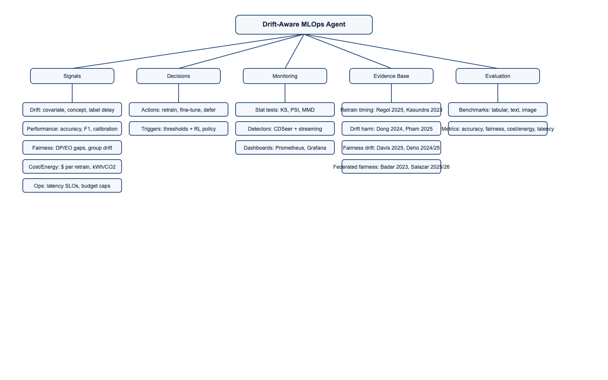

Deep read:

1. When to retrain a machine learning model (Regol et al., 2025; ICML/PMLR)
- What decision problem do they solve?
  - Decide when to retrain a deployed model under limited data, unknown shifts, and a cost trade-off between retraining and degraded performance.
- What signals do they ignore that you include?
  - Fairness drift, energy/carbon, latency, and operational budgets; they focus on performance + retraining cost trade-off rather than multi-objective signals.
- What assumptions do they make that you relax?
  - Assumes a bounded performance metric and a known (or at least specified) cost ratio; assumes the decision is primarily performance-vs-cost, not fairness/energy.
- Why fairness-aware retraining decisions cannot be static
  - Their formulation already treats performance as nonstationary; fairness is likewise nonstationary, so static fairness rules would be as brittle as static performance thresholds.

2. A Framework for Monitoring and Retraining Language Models in Real-World Applications (Kasundra et al., 2023)
- What decision problem do they solve?
  - Design a monitoring and continuous training strategy for LMs by choosing data splits, finetuning strategy, new-data inclusion policy, and retraining schedule (threshold vs fixed interval).
- What signals do they ignore that you include?
  - Fairness and group-level drift, energy/CO2, and explicit cost-aware scheduling; they focus on performance and resource utilization in a single-task MLC setting.
- What assumptions do they make that you relax?
  - Assumes a specific LM/MLC workflow and a particular monitoring metric (e.g., weighted F1); assumes retraining triggers are set by fixed thresholds or fixed intervals.
- Why fairness-aware retraining decisions cannot be static
  - Even with stable overall metrics, subgroup performance can drift; static thresholds on global metrics will miss fairness regressions.

3. Emerging algorithmic bias: fairness drift as the next dimension of model maintenance and sustainability (Davis et al., 2025)
- What decision problem do they solve?
  - Characterize fairness drift over time in clinical models and analyze how maintenance updates affect fairness gaps.
- What signals do they ignore that you include?
  - Explicit resource costs, energy/CO2, and automated policy decisions for retraining; they analyze fairness vs performance rather than optimizing a multi-objective schedule.
- What assumptions do they make that you relax?
  - Assumes a clinical domain and population-level model updates; fairness is monitored but not controlled via an agentic scheduler.
- Why fairness-aware retraining decisions cannot be static
  - They show fairness gaps drift over time and that updating can both help or worsen fairness; static fairness assumptions fail in practice.

4. Is it still fair? A comparative evaluation of fairness algorithms through the lens of covariate drift (Deho et al., 2024/2025)
- What decision problem do they solve?
  - Evaluate robustness of fairness algorithms under covariate drift across multiple datasets and metrics.
- What signals do they ignore that you include?
  - Retraining cost/energy, latency, and decision policies; they focus on fairness/accuracy outcomes under drift, not scheduling or operational constraints.
- What assumptions do they make that you relax?
  - Offline evaluation with fixed algorithms; no adaptive retraining mechanism or cost-aware policy.
- Why fairness-aware retraining decisions cannot be static
  - They show fairness varies over time and is not reliably correlated with drift magnitude, so static fairness interventions can be misleading.

5. When the Past != The Future: Assessing the Impact of Dataset Drift on the Fairness of Learning Analytics Models (Deho et al., 2024)
- What decision problem do they solve?
  - Quantify how dataset drift (covariate/target) impacts unfairness in learning analytics models.
- What signals do they ignore that you include?
  - Operational cost/energy, latency, and explicit retraining policy decisions; focus is diagnosis rather than decision-making.
- What assumptions do they make that you relax?
  - Static fairness algorithms and single-domain LA setting; no active retraining loop.
- Why fairness-aware retraining decisions cannot be static
  - They find that once-fair models can become unfair under drift; static fairness guarantees do not persist.

Overall understanding:

6. Efficiently Mitigating the Impact of Data Drift on ML Pipelines (Dong et al., VLDB 2024)
- What decision problem do they solve?
  - Identify harmful drifts by locating low-accuracy regions (DDLA) and retrain only when drift harms performance.
- What signals do they ignore that you include?
  - Fairness, energy/CO2, and latency; they use accuracy-focused harm signals rather than multi-objective signals.
- What assumptions do they make that you relax?
  - Focus on covariate shift and performance-only harm; no fairness-aware monitoring or cost/energy trade-off beyond retraining efficiency.
- Why fairness-aware retraining decisions cannot be static
  - Even if performance harm is localized, fairness harm can emerge in different regions or subgroups, requiring adaptive fairness-aware triggers.

7. Time to Retrain? Detecting Concept Drifts in ML Systems (Pham et al., ICSE 2025)
- What decision problem do they solve?
  - Detect real concept drift with minimal labels via CDSeer to decide when retraining is needed.
- What signals do they ignore that you include?
  - Fairness drift, energy/CO2, and cost-sensitive scheduling; focus is on detection quality and labeling efficiency.
- What assumptions do they make that you relax?
  - Assumes availability of limited labels and that concept drift detection is the primary trigger; not a multi-objective decision framework.
- Why fairness-aware retraining decisions cannot be static
  - Concept drift can be subgroup-specific, so fairness can degrade even when overall detection triggers are stable.

8. Unveiling Group-Specific Distributed Concept Drift (Salazar et al., TNNLS 2025/2026)
- What decision problem do they solve?
  - Formalize group-specific (and distributed) concept drift in federated learning and adapt drift handling to preserve fairness.
- What signals do they ignore that you include?
  - Cost/energy and end-to-end MLOps scheduling; they focus on FL adaptation mechanics rather than retraining cost trade-offs.
- What assumptions do they make that you relax?
  - Federated learning setting with group-specific drift; no centralized MLOps orchestration or multi-objective optimization.
- Why fairness-aware retraining decisions cannot be static
  - Group-specific drift implies fairness varies across groups and time; static policies cannot adapt to asymmetric drift.

9. FAC-Fed: Federated adaptation for fairness and concept drift aware stream classification (Badar et al., 2023)
- What decision problem do they solve?
  - Adapt federated stream learning to mitigate discrimination while handling concept drift, using adaptive augmentation.
- What signals do they ignore that you include?
  - Energy/CO2, latency, and explicit budget-constrained retraining policies; they focus on fairness + accuracy in FL streams.
- What assumptions do they make that you relax?
  - Federated setup with specific fairness metrics; no explicit cost-aware scheduling or multi-objective retraining agent.
- Why fairness-aware retraining decisions cannot be static
  - Stream data and non-IID client drift make fairness a moving target; static fairness constraints will misfire over time.

Mind map:

